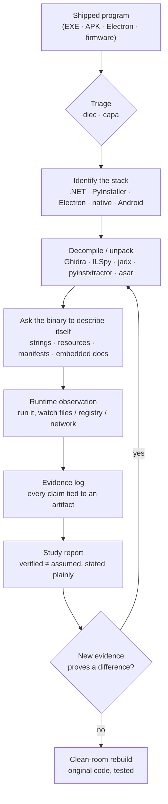

# Krouchi REA — مختبر الهندسة العكسية

**مختبر هندسة عكسية أصلي يعمل بالدليل أولاً**: المنهجية، وسكربت تثبيت الأدوات،
وتقارير الدراسة التي تقف وراء عائلة من إعادة البناء النظيفة لبرامج إدارة
مدرسية جزائرية.

بناء وصيانة: **كروشي عبد الرزاق** — مدير ثانوية بلقاسم محمد، تلمسان، الجزائر.

---

## ماذا في هذا المستودع

| الجزء | محتواه |
|---|---|
| [`skills/rea/`](skills/rea/SKILL.md) | طريقة العمل: دَع البرنامج يصف نفسه أولاً، اتبع الدليل، ولا تُعد البناء إلا حيث يثبت دليل جديد فرقاً |
| [`skills/re-nsa-library/`](skills/re-nsa-library/SKILL.md) | مكتبة الهندسة العكسية وأدوات NSA (ممارسة Ghidra ودروس التحقق) |
| [`install/`](install/install_tools.sh) | سكربت واحد يعيد بناء المختبر كله على جهاز جديد، مع [ملاحظات الأدوات](install/TOOLS_NOTES.md) المكتسبة بالتجربة |
| [`tools/bin/`](tools/bin/) | مشغّلات المختبر (`rea`، `capa`، `diec`، `ilspycmd`، `pyinstxtractor`، `asar`) |

## كيف تجري الدراسة



مخططات أخرى — خريطة الأدوات، بنية المختبر، مسار إعادة البناء:
[`docs/DIAGRAMS.md`](docs/DIAGRAMS.md).

## الأدوات

Ghidra 12.1.4 · وكلاء REA ‏6.8.0 · Hopper · jadx · ILSpy 8.2 · capa ‏10.0 ·
Detect It Easy 3.10 · pyinstxtractor · ‎@electron/asar — كلها موصولة تحت
`~/tools` ليعيش المختبر بعد تبديل الأجهزة.

```bash
bash install/install_tools.sh   # Ubuntu 24.04 / WSL
rea doctor                      # → healthy: true
```

## المبادئ

1. **الدليل أولاً.** قيمة أي قول عن برنامج هي قيمة الأثر الذي يثبته.
2. **دَع البرنامج يصف نفسه** قبل التجريب عليه.
3. **إعادة بناء نظيفة.** الدراسات تصف السلوك؛ والبرامج المبنية منها كود أصلي.
   لا شيء هنا يعيد إنتاج كود برنامج آخر.
4. **قُل ما لم يُختبَر.** كل تقرير يفصل المُتحقَّق من المفترَض.

## الدراسات

تقارير دراسة المختبر وثائق عمل: كل تقرير يعيش مع المشروع الذي يخدمه ولا
يُنشر هنا. ما ينشره هذا المستودع هو *الطريقة* — كيف يُفرز البرنامج ويُفكَّك
ويُراقَب ويتحوّل إلى مواصفة سلوك مُتحقَّقة — ليجري أي شخص العملية نفسها على
برامج يملكها.

## الشكر

الأدوات عمل ممتاز لأصحابها — Ghidra (NSA)، capa (Mandiant)، Detect It Easy،
ILSpy، jadx، pyinstxtractor، ‎@electron/asar، ومحرك rea-agents. السكربت
*يثبّتها* ولا يعيد توزيعها هنا. انظر [THIRD_PARTY_NOTICES.md](THIRD_PARTY_NOTICES.md).

المنهجية والسكربتات والمشغّلات وتقارير الدراسة في هذا المستودع عمل أصلي،
برخصة [MIT](LICENSE).

---

[English version](README.md)
