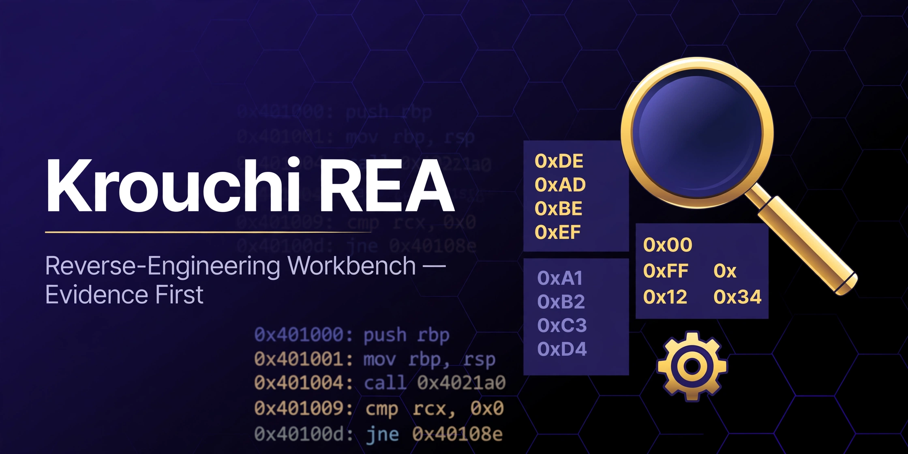
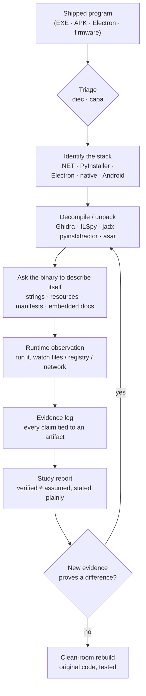

<div align="center">



# Krouchi REA

### مختبر الهندسة العكسية — الدليل أولاً

[](https://github.com/krouchi-abdelrazak/Krouchi_REA)
[](LICENSE)
[](https://github.com/NationalSecurityAgency/ghidra)
[](https://github.com/morluto/rea)
[](install/TOOLS_NOTES.md)

<p align="center">
  <a href="docs/DIAGRAMS.md"></a>
  <a href="install/install_tools.sh"></a>
  <a href="skills/rea/SKILL.md"></a>
  <a href="tools/bin/"></a>
</p>

**مختبر هندسة عكسية أصلي يعمل بالدليل أولاً** — المنهجية وسكربت تثبيت الأدوات
اللذان يقفان وراء عائلة من إعادة البناء النظيفة لبرامج إدارة مدرسية جزائرية.

*بناء وصيانة: **كروشي عبد الرزاق** — مدير ثانوية بلقاسم محمد، تلمسان، الجزائر.*

<p align="center">
  <a href="install/"></a>
  <a href="skills/rea/SKILL.md"></a>
  <a href="tools/bin/"></a>
  <a href="docs/DIAGRAMS.md"></a>
</p>

</div>

---

## 🚀 البدء السريع

```bash
bash install/install_tools.sh   # Ubuntu 24.04 / WSL — يعيد بناء المختبر كله تحت ~/tools
rea doctor                      # → healthy: true
```

## 📂 ماذا في هذا المستودع

| الجزء | محتواه |
|---|---|
| 🔬 [`skills/rea/`](skills/rea/SKILL.md) | طريقة العمل: دَع البرنامج يصف نفسه أولاً، اتبع الدليل، ولا تُعد البناء إلا حيث يثبت دليل جديد فرقاً |
| 📚 [`skills/re-nsa-library/`](skills/re-nsa-library/SKILL.md) | مكتبة الهندسة العكسية وأدوات NSA (ممارسة Ghidra ودروس التحقق) |
| 🛠️ [`install/`](install/install_tools.sh) | سكربت واحد يعيد بناء المختبر كله على جهاز جديد، مع [ملاحظات الأدوات](install/TOOLS_NOTES.md) المكتسبة بالتجربة |
| 🧰 [`tools/bin/`](tools/bin/) | مشغّلات المختبر (`rea`، `capa`، `diec`، `ilspycmd`، `pyinstxtractor`، `asar`) |
| 📊 [`docs/DIAGRAMS.md`](docs/DIAGRAMS.md) | خريطة الأدوات وبنية المختبر ومسار إعادة البناء — أربعة مخططات Mermaid بشرح عربي |

## 🔍 كيف تجري الدراسة



مخططات أخرى — خريطة الأدوات، بنية المختبر، مسار إعادة البناء:
[`docs/DIAGRAMS.md`](docs/DIAGRAMS.md).

## ⚙️ الأدوات

| الأداة | الإصدار | الدور |
|---|---|---|
| Ghidra | 12.1.4 | التفكيك الأصلي (NSA) |
| REA agents | 6.8.0 | محرك الوكلاء + جسور Hopper وjadx |
| jadx | headless MCP | تفكيك أندرويد |
| ILSpy | 8.2 | تفكيك ‎.NET |
| capa | 10.0 | فحص القدرات (Mandiant) |
| Detect It Easy | 3.10 | تعريف أولي للنوع |
| pyinstxtractor | 2.0 | فكّ حزم PyInstaller |
| ‎@electron/asar | 4.3.2 | فكّ حزم Electron |

كلها موصولة تحت `~/tools` ليعيش المختبر بعد تبديل الأجهزة.

## 📏 المبادئ

1. **الدليل أولاً.** قيمة أي قول عن برنامج هي قيمة الأثر الذي يثبته.
2. **دَع البرنامج يصف نفسه** قبل التجريب عليه.
3. **إعادة بناء نظيفة.** الدراسات تصف السلوك؛ والبرامج المبنية منها كود أصلي.
   لا شيء هنا يعيد إنتاج كود برنامج آخر.
4. **قُل ما لم يُختبَر.** كل تقرير يفصل المُتحقَّق من المفترَض.

## 📝 الدراسات

تقارير دراسة المختبر وثائق عمل: كل تقرير يعيش مع المشروع الذي يخدمه ولا
يُنشر هنا. ما ينشره هذا المستودع هو *الطريقة* — كيف يُفرز البرنامج ويُفكَّك
ويُراقَب ويتحوّل إلى مواصفة سلوك مُتحقَّقة — ليجري أي شخص العملية نفسها على
برامج يملكها.

## 🙏 الشكر

الأدوات عمل ممتاز لأصحابها — Ghidra (NSA)، capa (Mandiant)، Detect It Easy،
ILSpy، jadx، pyinstxtractor، ‎@electron/asar، ومحرك rea-agents. السكربت
*يثبّتها* ولا يعيد توزيعها هنا. انظر [THIRD_PARTY_NOTICES.md](THIRD_PARTY_NOTICES.md).

المنهجية والسكربتات والمشغّلات وتقارير الدراسة في هذا المستودع عمل أصلي،
برخصة [MIT](LICENSE).

---

<div align="center">

[English version](README.md)

</div>
