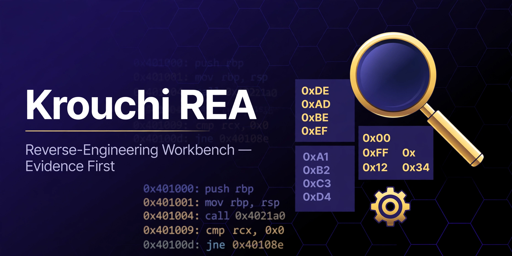
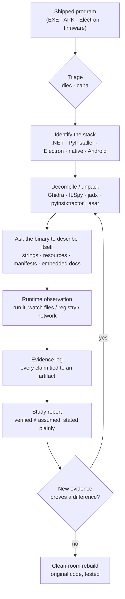

<div align="center">



# Krouchi REA

### Reverse-Engineering Workbench — Evidence First

[](https://github.com/krouchi-abdelrazak/Krouchi_REA)
[](LICENSE)
[](https://github.com/NationalSecurityAgency/ghidra)
[](https://github.com/morluto/rea)
[](install/TOOLS_NOTES.md)

<p align="center">
  <a href="docs/DIAGRAMS.md"></a>
  <a href="install/install_tools.sh"></a>
  <a href="skills/rea/SKILL.md"></a>
  <a href="tools/bin/"></a>
</p>

**An original, evidence-first reverse-engineering lab** — the methodology and
the tool bootstrap behind a family of clean-room rebuilds of Algerian
school-administration software.

*Built and maintained by **Krouchi Abderrazak** — director of Lycée Belkacem Mohamed, Tlemcen, Algeria.*

<p align="center">
  <a href="install/"></a>
  <a href="skills/rea/SKILL.md"></a>
  <a href="tools/bin/"></a>
  <a href="docs/DIAGRAMS.md"></a>
</p>

</div>

---

## 🚀 Quick start

```bash
bash install/install_tools.sh   # Ubuntu 24.04 / WSL — rebuilds the whole lab under ~/tools
rea doctor                      # → healthy: true
```

## 📂 What is in here

| Part | What it holds |
|---|---|
| 🔬 [`skills/rea/`](skills/rea/SKILL.md) | The REA working method: ask the binary to describe itself first, follow the evidence, rebuild only where new evidence proves a difference |
| 📚 [`skills/re-nsa-library/`](skills/re-nsa-library/SKILL.md) | The reverse-engineering & NSA-tooling library notes (Ghidra practice, verification lessons) |
| 🛠️ [`install/`](install/install_tools.sh) | One bootstrap script that rebuilds the whole lab on a fresh machine, plus the hard-won [toolchain notes](install/TOOLS_NOTES.md) |
| 🧰 [`tools/bin/`](tools/bin/) | The launchers the lab runs on (`rea`, `capa`, `diec`, `ilspycmd`, `pyinstxtractor`, `asar`) |
| 📊 [`docs/DIAGRAMS.md`](docs/DIAGRAMS.md) | Tool map, lab layout and clean-room flow — four Mermaid diagrams with Arabic summaries |

## 🔍 How a study flows



More diagrams — tool map, lab layout, clean-room flow:
[`docs/DIAGRAMS.md`](docs/DIAGRAMS.md).

## ⚙️ The toolchain

| Tool | Version | Role |
|---|---|---|
| Ghidra | 12.1.4 | Native decompilation (NSA) |
| REA agents | 6.8.0 | Agent engine + Hopper / jadx bridges |
| jadx | headless MCP | Android decompilation |
| ILSpy | 8.2 | .NET decompilation |
| capa | 10.0 | Capability scanning (Mandiant) |
| Detect It Easy | 3.10 | First-pass identification |
| pyinstxtractor | 2.0 | PyInstaller unpacking |
| @electron/asar | 4.3.2 | Electron unpacking |

All wired under `~/tools` so the lab survives machine replacements.

## 📏 Principles

1. **Evidence first.** A claim about a program is worth exactly the artifact
   that proves it — a string, a resource, a trace, a screenshot.
2. **Ask the binary to describe itself** before experimenting on it.
3. **Clean-room rebuilds.** Studies describe behaviour; the software built
   from them is original code. Nothing here reproduces another program's code.
4. **Say what was not tested.** Every report separates the verified from the
   assumed.

## 📝 Studies

The lab's study reports are working documents: each one lives with the
project it serves and is not published here. What this repository publishes
is the *method* — how a program is triaged, decompiled, observed and turned
into a verified behaviour spec — so anyone can run the same process on
software they own.

## 🙏 Credits

The tools are other people's excellent work — Ghidra (NSA), capa (Mandiant),
Detect It Easy (horsicq), ILSpy, jadx, pyinstxtractor, @electron/asar, and
the rea-agents engine. They are *installed* by the bootstrap script, never
redistributed here. See [THIRD_PARTY_NOTICES.md](THIRD_PARTY_NOTICES.md).

The methodology, scripts, launchers and study reports in this repository are
original work, released under the [MIT License](LICENSE).

---

<div align="center">

[النسخة العربية](README.ar.md)

</div>
