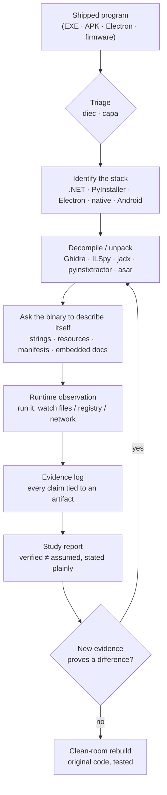
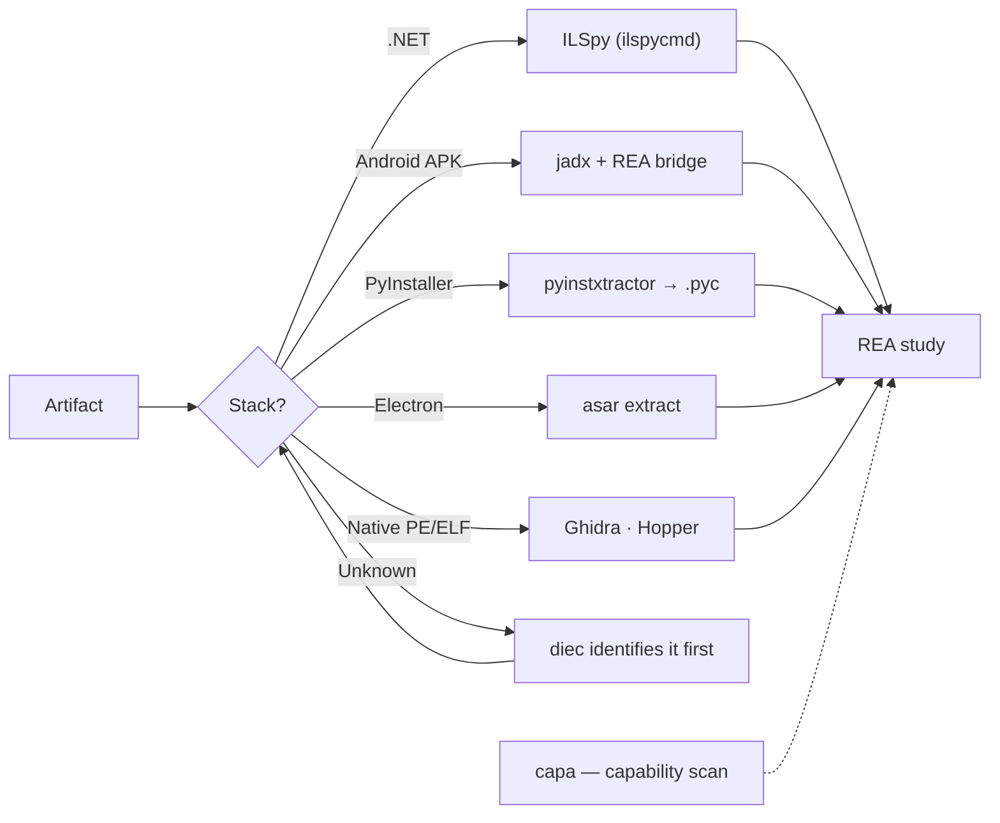
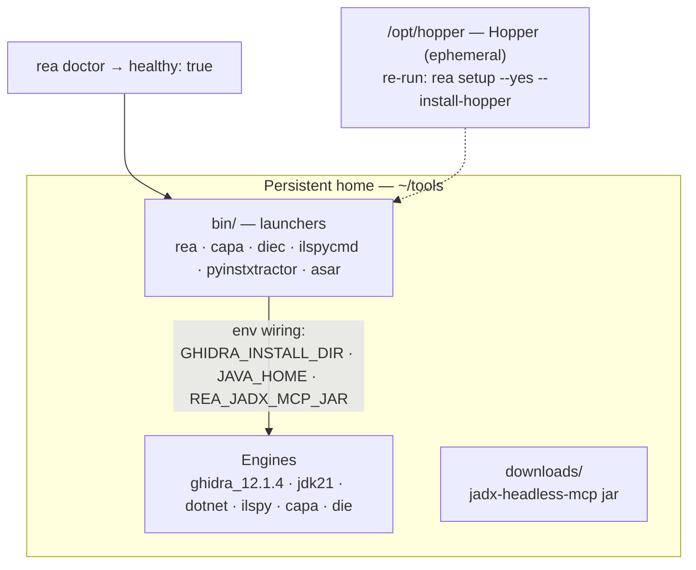
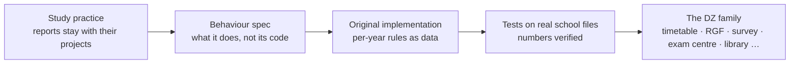

# Diagrams — how the lab works

GitHub renders these Mermaid diagrams natively. Arabic summaries under each.

## 1 · The study pipeline — from a shipped program to a verified study

**بالعربية:** من البرنامج الجاهز → فرز أولي (نوعه وحزمته) → فكّ وتفكيك →
دَع البرنامج يصف نفسه (نصوصه وموارده ووثائقه المدمجة) → مراقبة وقت التشغيل →
سجلّ أدلة → تقرير دراسة يفصل المُتحقَّق من المفترَض → إعادة بناء نظيفة بكود
أصلي مختبَر. ولا يُعاد فتح أي جزء إلا بدليل جديد يثبت فرقاً.

## 2 · Which tool for which artifact

**بالعربية:** كل نوع برنامج له أداته: ‏.NET إلى ILSpy، أندرويد إلى jadx،
بايثون المجمّد إلى pyinstxtractor، إلكترون إلى asar، والأصلي إلى Ghidra —
وdiec يعرف النوع أولاً، وcapa يفحص القدرات.

## 3 · The lab layout — why it survives machine replacements

**بالعربية:** كل شيء تحت `~/tools` في المجلد الدائم؛ المشغّلات توصِل المحركات
بمتغيرات بيئة صريحة، وما يعيش في مسارات مؤقتة (Hopper) يُعاد تثبيته بأمر واحد.

## 4 · From studies to the DZ family — clean-room only

**بالعربية:** الدراسة تنتج «مواصفة سلوك» لا كوداً منقولاً؛ التنفيذ أصلي من
الصفر، والقواعد الرقمية بيانات مرقّمة حسب السنة الدراسية، والفحص على ملفات
المدرسة الحقيقية.
